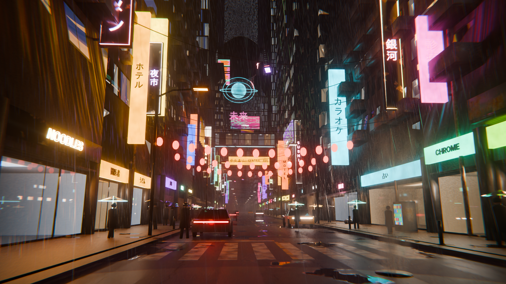

# Procedural Blender scenes — Cycles

Each scene is one Python script that builds everything (geometry, materials, lights,
camera, render and compositor settings) inside Blender.

- [**Cyberpunk city**](#cyberpunk-city): a rain-soaked neon street at night (`cyberpunk_city.py`)
- [**Forest**](#forest): a misty beech and oak forest at sunrise (`forest_scene.py`)

---

## Cyberpunk city



*2560 × 1440, Cycles, 96 samples + OpenImageDenoise, rendered with
`python cyberpunk_city.py --preset final --render cyberpunk_city_1440p.png`. Nothing was
retouched outside Blender.*

### What's in the scene

- **Street canyon:** a 760 m street with a cross street. Both sides are lined with
  generated buildings: podiums with set-back towers, ledges, fins, balconies, AC units, drain pipes,
  parapets, water tanks and antenna masts with red beacons.
- **Shopfronts:** recessed, lit shop windows, roll-down shutters, awnings, and fascia signs
  over every shop.
- **Signs:** about 160 pieces of sign lettering in Japanese and English.
  - neon tube lettering
  - backlit lightbox blade signs
  - LED billboards with procedural ad graphics and a visible pixel grid
  - a hanging street sign
  - a cyan hologram over the street

  All brand names are made up.
- **Windows:** an *interior-mapping* shader. Each lit window shows a virtual room with walls,
  floor, ceiling light, furniture silhouettes, curtains or blinds, all with correct parallax.
  Every room gets its own random light colour, and a few dark rooms flicker with a TV.
- **Wet ground:** scanned asphalt and pavers with puddles and rain-drop ripples. Tyre tracks
  are smoother than the rest of the road. There's worn lane paint, zebra crossings, manholes
  and drains.
- **Street life:** lamps (LED and sodium), vending machines, bollards, rubbish bags, parked
  cars, and pedestrians under umbrellas (some clear, with LED shafts).
- **Overhead:** about 55 sagging cables, three strings of red paper lanterns, and a glass
  skybridge with a billboard.
- **Sky:** flying cars (two sweep the street with searchlights), rooftop searchlights, second-row
  towers, and a far skyline closed off by a 900 m megastructure with giant screens.
- **Atmosphere:** about 30k rain streaks turned to face the lens, steam plumes from the
  manholes, and two-layer volumetric haze that gives every light a halo.
- **Lens and finish:**
  - 22 mm at f/2.8, with slightly oval bokeh
  - AgX High Contrast tone mapping
  - bloom, lateral chromatic aberration, slight barrel distortion and a vignette

### Requirements

- Blender **4.2 or newer** (tested with 5.2 LTS through the `bpy` module), or `pip install bpy`.
- About 2 GB of RAM.
- **Textures:** road, pavers, walls and metal use CC0 scans from
  [Poly Haven](https://polyhaven.com). On the first run the script downloads 18 maps at 2K
  (31 MB) into `textures/` next to the script. With `--offline`, or without network access,
  it falls back to procedural materials. They're plainer, but the scene still builds.
- **Japanese signs** need a CJK font. The script looks for IPAGothic, Noto Sans CJK,
  WenQuanYi, Yu Gothic, Meiryo, MS Gothic or Hiragino. If it finds none, every sign is in
  English.

### Prebuilt .blend

[`blend/cyberpunk_city.blend`](blend/cyberpunk_city.blend) (40 MB) is the scene above, ready
to open. It was saved with **Blender 5.2 LTS**, so use 5.2 or newer. The sign text has been
converted to meshes and the textures are packed, so it needs no fonts, downloads or add-ons.
Open it and press **F12**. For older Blender versions, generate the file with your own
Blender (see below).

### Usage

**Blender GUI:** go to the *Scripting* workspace, choose *Text › Open…*, open
`cyberpunk_city.py`, and press *Run Script*. The city is built in a few seconds into a new
scene called **Cyberpunk City**. Press **F12** to render.

**Command line:**

```bash
# the 1440p image above
blender -b -P cyberpunk_city.py -- --preset final --render city_1440p.png

# quick look (960x540)
blender -b -P cyberpunk_city.py -- --preset draft --render draft.png

# build and save a self-contained .blend (text as meshes, textures packed)
blender -b -P cyberpunk_city.py -- --preset final --save city.blend --pack
```

**Without a Blender install** (the PyPI `bpy` module):

```bash
pip install bpy
python cyberpunk_city.py --preset final --render city_1440p.png
```

| option | meaning |
|---|---|
| `--preset draft\|preview\|final\|ultra` | resolution and samples (see below) |
| `--res WxH`, `--samples N` | override the preset |
| `--gpu` | render on the GPU (OptiX, CUDA, HIP, Metal or oneAPI) |
| `--seed N` | a different city layout (default 4) |
| `--no-fog`, `--no-rain` | skip the volumetric haze or the rain streaks |
| `--offline`, `--tex-dir PATH` | never download textures, or where to cache them |
| `--render PATH` | render a still. A `.exr` path writes linear HDR |
| `--save PATH`, `--pack` | save the generated `.blend`, optionally self-contained |
| `--threads N` | limit the CPU render threads |

| preset | resolution | samples |
|---|---|---|
| `draft` | 960 × 540 | 24 |
| `preview` | 1600 × 900 | 48 |
| `final` | 2560 × 1440 (1440p) | 96 |
| `ultra` | 3840 × 2160 (4K) | 160 |

The `final` image took **48 minutes** on a 4-core Xeon CPU with no GPU. Building the scene
itself takes about 5 seconds. `draft` takes about 1.5 minutes on the same machine. A GPU
(`--gpu`) should be far faster, but I couldn't measure one here.

### Tweaking

The art direction is at the top of `cyberpunk_city.py`:

- `LOOK`: camera position, lens, tilt, aperture, focus, exposure, AgX look, fog densities
  and the amount and lean of the rain.
- `STREET`: road and pavement widths, street length, and where the cross street is.
- `NEON`: the sign colour palette.
- `JP_WORDS`, `EN_WORDS`, `BRANDS`: what the signs say.
- `TEXTURES`: which Poly Haven scans to use.

### Things to know

- **It's built for this camera.** Shopfronts, signs and facade clutter are only generated
  within about 180 m of the camera, and rain only fills the view in front of the lens. If
  you fly around in Blender you'll find plain boxes further out, and dry air behind you.
  To reframe, change `LOOK` and re-run the script.
- **People and cars are simple stand-ins.** They read well as silhouettes in the rain at this
  distance, but they fall apart in a close-up. The same goes for the interiors: interior
  mapping sells depth from the street, not from right up against the glass.
- **Rain streaks are static geometry**, pre-stretched to look like a 1/50 s exposure. That's
  right for a still. For animation you'd want a particle system with motion blur.
- **Noise:** neon, haze and many small lights are hard work for a path tracer. 96 samples
  plus the denoiser is clean at 1440p. Below about 48 samples the haze gets blotchy.

---

## Forest

*Procedural photorealistic forest — `forest_scene.py`*


*2560 × 1440 (1440p), Cycles, 48 samples + OpenImageDenoise, rendered with
`python forest_scene.py --preset final`. There is no retouching outside Blender.*

**Video:** [`renders/forest_walk_10s.mp4`](renders/forest_walk_10s.mp4) is a 10-second walk
down the footpath (960 × 540, 24 fps, H.264).

One Python file builds the whole scene. It downloads no textures, HDRIs or models and
needs no add-ons: every mesh and material is generated by code.

### What's in the scene

- **Terrain**: about 600 × 435 m of gently rolling forest floor with a worn footpath. The
  grid is dense near the camera and coarse far away.
- **Trees**: procedural beech and oak. Each has a trunk with root flare and buttresses,
  buried surface roots, dead stubs, and limbs that branch down to twigs, carrying 45k–290k
  individual leaf meshes per tree. Young beech saplings form the understory. About 2,350
  instanced trees fill the whole view cone, so the forest never visibly ends.
- **Ground cover**: ferns with arching fronds and lobed pinnae, grass tufts along the path,
  about 55k leaf-litter leaves, fallen twigs, mossy boulders and a fallen log.
- **Materials** (all procedural):
  - smooth beech bark with lichen, algae streaks and basal moss
  - furrowed oak bark
  - translucent leaves with veins and per-leaf colour variation
  - forest floor, mossy rock, and weathered deadwood with bare patches
- **Light and lens**:
  - physical sky with a low, warm sun
  - volumetric haze for the light shafts
  - AgX tone mapping
  - a compositor finish: bloom, a hint of chromatic aberration, and a vignette
  - a 26 mm lens at f/4 with depth of field

### Requirements

- Blender **4.2 or newer**. Tested with 4.5 LTS and 5.0. Alternatively, use the `bpy`
  module (`pip install bpy`, Python 3.11).
- About **9 GB of free RAM** for the `final` preset. Draft and preview need less.

### Usage

**Blender GUI:** go to the *Scripting* workspace, choose *Text › Open…*, open
`forest_scene.py`, and press *Run Script*. The forest is built into a new scene called
**Forest** in about a minute. Press **F12** to render.

**Command line:**

```bash
# the 1440p image above
blender -b -P forest_scene.py -- --preset final --render forest_1440p.png

# quick look (960x540)
blender -b -P forest_scene.py -- --preset draft --render draft.png

# just build and save the .blend
blender -b -P forest_scene.py -- --save forest.blend
```

**Without a Blender install** (the PyPI `bpy` module):

```bash
pip install bpy
python forest_scene.py --preset final --render forest_1440p.png
```

| option | meaning |
|---|---|
| `--preset draft\|preview\|final\|video` | resolution, samples and scatter density (see below) |
| `--res WxH`, `--samples N` | override the preset |
| `--gpu` | render on the GPU (OptiX, CUDA, HIP, Metal or oneAPI) |
| `--seed N` | a different forest layout (default 7) |
| `--season autumn` | autumn foliage and litter colours |
| `--no-fog` | skip the volumetric haze (much faster, loses the light shafts) |
| `--render PATH` | render a still. A `.exr` path writes linear HDR. With `--animate`, a `.mp4` path gets the encoded video |
| `--animate SECONDS` | walk the camera down the path for this long (see *Camera move* below) |
| `--fps N`, `--speed M_PER_S` | frame rate (default 24) and walking speed (default 1.4 m/s) |
| `--save PATH` | save the generated `.blend` |
| `--threads N` | limit the CPU render threads |

| preset | resolution | samples | scatter density |
|---|---|---|---|
| `draft` | 960 × 540 | 32 | 45 % |
| `preview` | 1280 × 720 | 48 | 100 % |
| `final` | 2560 × 1440 (1440p) | 48 | 100 % |
| `video` | 960 × 540 | 12 (lighter bounce budget) | 100 % |

The `final` image above took **26 minutes** on a 4-core Xeon CPU with no GPU, including about
1 minute of scene generation. `draft` and `preview` are proportionally quicker. A GPU
(`--gpu`) should be much faster, but I couldn't measure one here. For a cleaner image, raise
`--samples`; the time scales about linearly.

### Camera move (video)

`--animate SECONDS` turns the still into a shot that walks down the footpath at eye height.
The camera looks about 9 m ahead along the path and has a faint handheld drift, and it
passes the big beech and the fallen log.

```bash
# 10 s walk, 960x540 (this is what renders/forest_walk_10s.mp4 used)
blender -b -P forest_scene.py -- --preset video --animate 10 --render forest_walk.mp4

# the same shot at 1440p, on a GPU
blender -b -P forest_scene.py -- --preset final --animate 10 --gpu --render forest_walk_1440p.mp4
```

- **Frames and encoding.** Frames are written as PNGs to `<name>_frames/` and then encoded
  to H.264 with Blender's own FFmpeg, so there's nothing extra to install. Re-running the
  same command skips frames that already exist, so an interrupted render resumes.
- **Scatter coverage.** Ground cover is scattered for everything the camera sees along the
  whole move, not just the first frame.
- **Persistent data.** Only the camera moves, so Cycles keeps the scene between frames and
  only the first frame pays the setup cost.
- **Render time.** On the 4-core CPU used here, the `video` preset took 50 s per frame. The
  10 s clip (240 frames) took 3 h 23 min including scene setup. 1440p costs about 7× more per
  frame, which is why that command is GPU territory.

### Tweaking

All the art direction lives at the top of `forest_scene.py`:

- `LOOK`: camera position, lens, aperture, focus, sun azimuth/elevation/strength/colour,
  sky fill, fog density and anisotropy, exposure, and the AgX look.
- `PATH_POINTS`: the course of the footpath.
- `SPECIES`: tree architecture (height, crown base, branching angles and densities,
  leaves per metre, leaf size).
- `PRESETS`: resolution, samples and density per preset.

### Getting a .blend file

The `.blend` isn't in the repo: the scene holds about 17 million vertices (mostly individual
leaves), which makes the saved file about 630 MB, over GitHub's 100 MB per-file limit. It's
reproducible in about two minutes instead:

```bash
# still, 1440p settings
blender -b -P forest_scene.py -- --preset final --save forest.blend

# same, with the camera keyframed for the 10 s walk (frames 1-240)
blender -b -P forest_scene.py -- --preset final --animate 10 --save forest_walk.blend
```

**Prebuilt file.** The 10 s walk version (the exact file used for the video) is in
[`blend/`](blend/) as four pieces of one xz archive (363 MB total, 628 MB extracted; Blender 5.0).
The one-click way: on the repo page choose *Code › Download ZIP* (with this branch selected).
That single ZIP contains the four pieces in its `blend/` folder. Put them in one folder, then:

- **Windows / 7-Zip:** right-click `forest_full.blend.xz.001` › 7-Zip › *Extract here*, then
  right-click the resulting `forest_full.blend.xz` › *Extract here* again.
- **Windows (no 7-Zip):** `copy /b forest_full.blend.xz.001+forest_full.blend.xz.002+forest_full.blend.xz.003+forest_full.blend.xz.004 forest_full.blend.xz`, then extract with 7-Zip.
- **macOS / Linux:** `cat forest_full.blend.xz.00* > forest_full.blend.xz && xz -d forest_full.blend.xz`

The sha256 of the reassembled `.xz` is `49b43082200a3f1ac887af708ee8cc43e069c9e0b9661f6e136c1280cc50201f`.

**Known issue in this prebuilt file:** it was saved before a viewport bug was fixed, so the 3D
viewport shows only the terrain, rocks and the foreground tree (renders are fine). Open the
file, run [`fix_viewport.py`](fix_viewport.py) from the *Scripting* workspace, then save. Files
generated with the current `forest_scene.py` don't need it.

Or open `forest_scene.py` in Blender's *Scripting* workspace and run it, then use
*File › Save As*. A `.blend` saved from Blender 5.0 opens in 5.0 or newer. Generate it with
your own Blender version if you use 4.x.

### Things to know

- **Scattering follows the camera.** Leaf litter, ferns, grass, twigs, rocks and saplings
  are only generated inside what the camera sees: the view cone for a still, or the whole
  move with `--animate`. That keeps memory reasonable. If you move the camera by hand in
  Blender, you'll find bare ground outside the original view. To reframe, change `LOOK` (or
  `PATH_POINTS`) and re-run the script.
- **The viewport shows a subset of the instances.** It displays only 10–50% of them (a
  Geometry Nodes *Is Viewport* switch) to stay interactive. Renders always get everything.
- **It's procedural, not photoscanned.** The scene holds up at the framing it was built
  for. Extreme close-ups of bark or leaves still look CG. The next step up in realism
  would be scanned textures and plants (e.g. Poly Haven or Megascans), which this
  environment couldn't download.
- **Volumetrics dominate the render time.** `--no-fog` is the quickest way to iterate on
  layout.
