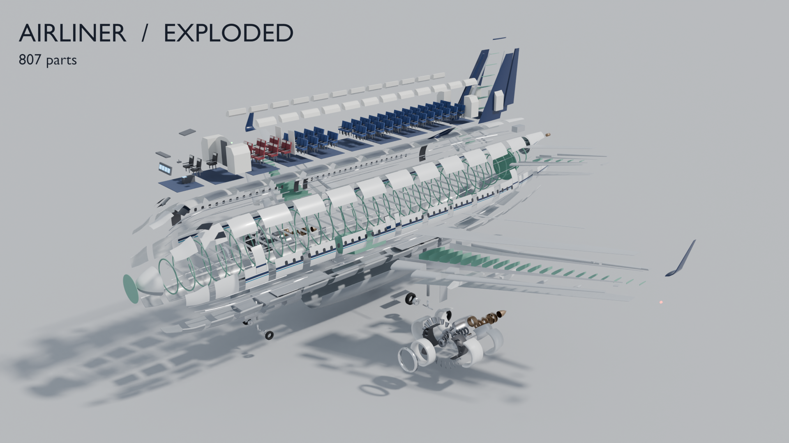
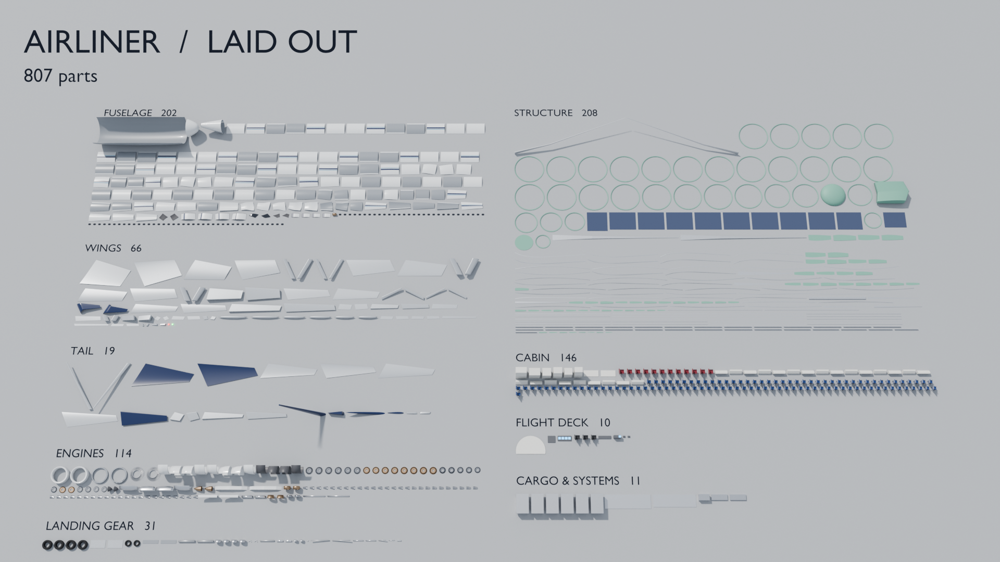
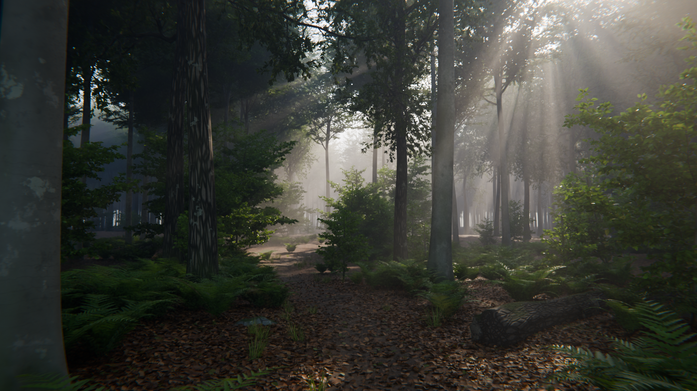

# Procedural Blender scenes

Two self-contained Python generators. Neither downloads textures, HDRIs or models.

- [**Airliner**](#airliner--807-separate-parts-five-display-modes): a twin-engine passenger jet built from 807 separate parts, with finished, X-ray, cutaway, exploded and laid-out modes (`airliner.py`)
- [**Forest**](#procedural-photorealistic-forest--blender--cycles): a photorealistic beech and oak forest at sunrise (`forest_scene.py`)

---

# Airliner — 807 separate parts, five display modes


`airliner.py` builds a generic narrow-body twin jet (A320/737 class, about 37.6 m long with a
35.8 m span) as **807 individual objects**. Every panel, rib, seat and fan blade is its own part
and can be selected, hidden or moved on its own. A sidebar panel switches between five modes and
shows a live part count.

| X-ray | Cutaway |
|---|---|
|  |  |
| **Exploded** | **Laid out** |
|  |  |

**Video:** [`renders/airliner_modes.mp4`](renders/airliner_modes.mp4) is a 31-second tour through
all five modes (1280 × 720, 24 fps, EEVEE). Cutaway panels peel off one by one while the
caption counts down the parts still shown. The parts then explode by system, arc down onto the
floor into the parts sheet, and finally fly back in and reassemble the plane system by system,
from the frames and floor up to the skin. Render it again with:

```bash
blender -b -P airliner_video.py -- --out renders/airliner_modes.mp4
```

`--engine cycles` switches to Cycles (slower), `--res` and `--fps` change the format, and
`--frames 0-47` renders a short range as a preview. Frames are written to
`renders/airliner_modes_frames/` and reused if the render is interrupted. On this 4-core
machine with no GPU, EEVEE ran on the Mesa software renderer at about 15 s per frame. A GPU is
much faster.

## The modes

| mode | what it does |
|---|---|
| **Finished** | the complete aircraft, parked on its gear |
| **X-ray** | the outer skin (315 parts) turns to cyan glass. Everything inside glows in its system colour: structure white, cabin amber, flight deck orange, engines red-orange, landing gear magenta, cargo and systems green |
| **Cutaway** | a stepped section of skin is removed down the left side, along with the left overhead bins, the upper skin of the left wing, half the left engine's cowls and casings, and the left skins of the fin and stabiliser. 101 parts are hidden and the count drops to 706 |
| **Exploded** | every part moves away from its neighbours along its own assembly direction: skin panels radially outwards, cabin and flight deck up in a layer above, wings outboard, the engines apart along their axis with the fan blades flung radially, and the gear down. A slider sets the distance (0–2.5×) and updates live |
| **Laid out** | every part is laid flat on the floor, sorted by size and grouped into labelled blocks per system, each label showing its part count. Thin parts are laid on their widest face, and tall parts such as struts and the rudder are laid down |

Switching modes animates the parts to their new positions, and the camera moves to a framing
that suits each mode. Both can be turned off in the panel.

## What's modelled (part counts)

| system | parts | includes |
|---|---|---|
| Fuselage | 202 | radome, 112 skin panels (14 sections × 8) carrying a painted livery, tail cone, APU exhaust, 70 cabin windows, 6 flight-deck windows, 10 doors and exits (with seals), belly fairing |
| Structure | 208 | 33 frames, 66 stringers (spliced at three production breaks), cabin floor panels and beams, forward and aft pressure bulkheads, keel beam, centre wing box; wing, fin and stabiliser spars and ribs |
| Cabin | 146 | 12 business and 102 economy seats, 24 overhead bins, galleys, lavatories, cabin dividers |
| Engines | 114 | per engine: inlet lip and cowl, split fan cowls, fan cases, thrust reversers and core cowls, spinner, fan disk, **24 fan blades**, outlet guide vanes, 3 booster, 5 HP compressor, 1 HP turbine and 4 LP turbine stages, combustor, 2 shafts, nozzle, plug, pylon, pylon fairing |
| Wings | 66 | per wing: 3 upper and 3 lower skins, trailing-edge panels, fixed leading edges, 5 slats, 2 flaps, aileron, 5 spoilers, 3 flap-track fairings, winglet, navigation light |
| Landing gear | 31 | nose and main struts, pistons, braces, torque links, axles, tyres and hubs, gear doors |
| Tail | 19 | fin leading edge, skins, rudder, tip and dorsal fillet; stabiliser leading edges, skins, elevators and tips |
| Cargo & systems | 11 | 6 LD3 containers, cargo floors, APU, two air-conditioning packs |
| Flight deck | 10 | bulkhead and door, pilot and observer seats, instrument panel with lit displays, glareshield, pedestal, overhead panel, sidesticks |

## Usage

**Blender GUI (4.2 or newer):** open `airliner.py` in the *Scripting* workspace and press
*Run Script*. The aircraft is built into a new scene called **Airliner** in about a second.
Press **N** in the 3D viewport and open the **Airliner** tab.

**Prebuilt file:** [`blend/airliner.blend`](blend/airliner.blend) (1.2 MB, saved from Blender
5.0). The mode panel is stored inside it as the text block `airliner_ui.py`. Blender doesn't run
scripts from a file until you allow it. Click **Allow Execution** in the warning bar, or open the
text block in the Text Editor and press *Run Script*.

**Command line:**

```bash
# the five renders above (1920x1080, Cycles, 64 samples)
blender -b -P airliner.py -- --render-all renders/

# one mode
blender -b -P airliner.py -- --mode cutaway --render cutaway.png

# build and save a .blend
blender -b -P airliner.py -- --save airliner.blend
```

Without a Blender install, `pip install bpy` (Python 3.11) and run `python airliner.py ...` with
the same options.

| option | meaning |
|---|---|
| `--mode finished\|xray\|cutaway\|exploded\|layout` | the mode to render and to leave the scene in |
| `--explode F` | explode distance multiplier (default 1.0) |
| `--render PATH` | render the chosen mode |
| `--render-all DIR` | render all five modes as `DIR/airliner_<mode>.png` |
| `--res WxH`, `--samples N` | resolution (default 1920x1080) and Cycles samples (default 64) |
| `--no-hud` | leave the caption and part count out of the renders |
| `--save PATH` | save the `.blend` |

Each 1080p render takes 1–2 minutes on a 4-core CPU.

## Things to know

- **It's a generic airliner, not a specific type.** The proportions follow the A320/737 class
  and the livery is made up. It's built for clarity at whole-aircraft scale, so there are no
  rivets, hinges, wiring or hydraulic lines.
- **Parts are in their real positions.** Each part's origin sits at its own centre, so you can
  grab any part in Finished mode and move it. Mode switches restore the stored positions, so
  hand edits are overwritten by the next mode change.
- **X-ray in the viewport** needs *Material Preview* or *Rendered* shading. The script switches
  the viewport to Material Preview for you.
- **Running the script again** in the same file makes a second, independent Airliner scene. The
  panel only counts and moves the parts of the scene you're looking at.

---

# Procedural photorealistic forest — Blender + Cycles



*2560 × 1440 (1440p), Cycles, 48 samples + OpenImageDenoise, rendered with
`python forest_scene.py --preset final`. There is no retouching outside Blender.*

**Video:** [`renders/forest_walk_10s.mp4`](renders/forest_walk_10s.mp4) is a 10-second walk
down the footpath (960 × 540, 24 fps, H.264).

One Python file builds the whole scene. It downloads no textures, HDRIs or models and
needs no add-ons: every mesh and material is generated by code.

## What's in the scene

- **Terrain**: about 600 × 435 m of gently rolling forest floor with a worn footpath. The
  grid is dense near the camera and coarse far away.
- **Trees**: procedural beech and oak. Each has a trunk with root flare and buttresses,
  buried surface roots, dead stubs, and limbs that branch down to twigs, carrying 45k–290k
  individual leaf meshes per tree. Young beech saplings form the understory. About 2,350
  instanced trees fill the whole view cone, so the forest never visibly ends.
- **Ground cover**: ferns with arching fronds and lobed pinnae, grass tufts along the path,
  about 55k leaf-litter leaves, fallen twigs, mossy boulders and a fallen log.
- **Materials** (all procedural):
  - smooth beech bark with lichen, algae streaks and basal moss
  - furrowed oak bark
  - translucent leaves with veins and per-leaf colour variation
  - forest floor, mossy rock, and weathered deadwood with bare patches
- **Light and lens**:
  - physical sky with a low, warm sun
  - volumetric haze for the light shafts
  - AgX tone mapping
  - a compositor finish: bloom, a hint of chromatic aberration, and a vignette
  - a 26 mm lens at f/4 with depth of field

## Requirements

- Blender **4.2 or newer**. Tested with 4.5 LTS and 5.0. Alternatively, use the `bpy`
  module (`pip install bpy`, Python 3.11).
- About **9 GB of free RAM** for the `final` preset. Draft and preview need less.

## Usage

**Blender GUI:** go to the *Scripting* workspace, choose *Text › Open…*, open
`forest_scene.py`, and press *Run Script*. The forest is built into a new scene called
**Forest** in about a minute. Press **F12** to render.

**Command line:**

```bash
# the 1440p image above
blender -b -P forest_scene.py -- --preset final --render forest_1440p.png

# quick look (960x540)
blender -b -P forest_scene.py -- --preset draft --render draft.png

# just build and save the .blend
blender -b -P forest_scene.py -- --save forest.blend
```

**Without a Blender install** (the PyPI `bpy` module):

```bash
pip install bpy
python forest_scene.py --preset final --render forest_1440p.png
```

| option | meaning |
|---|---|
| `--preset draft\|preview\|final\|video` | resolution, samples and scatter density (see below) |
| `--res WxH`, `--samples N` | override the preset |
| `--gpu` | render on the GPU (OptiX, CUDA, HIP, Metal or oneAPI) |
| `--seed N` | a different forest layout (default 7) |
| `--season autumn` | autumn foliage and litter colours |
| `--no-fog` | skip the volumetric haze (much faster, loses the light shafts) |
| `--render PATH` | render a still. A `.exr` path writes linear HDR. With `--animate`, a `.mp4` path gets the encoded video |
| `--animate SECONDS` | walk the camera down the path for this long (see *Camera move* below) |
| `--fps N`, `--speed M_PER_S` | frame rate (default 24) and walking speed (default 1.4 m/s) |
| `--save PATH` | save the generated `.blend` |
| `--threads N` | limit the CPU render threads |

| preset | resolution | samples | scatter density |
|---|---|---|---|
| `draft` | 960 × 540 | 32 | 45 % |
| `preview` | 1280 × 720 | 48 | 100 % |
| `final` | 2560 × 1440 (1440p) | 48 | 100 % |
| `video` | 960 × 540 | 12 (lighter bounce budget) | 100 % |

The `final` image above took **26 minutes** on a 4-core Xeon CPU with no GPU, including about
1 minute of scene generation. `draft` and `preview` are proportionally quicker. A GPU
(`--gpu`) should be much faster, but I couldn't measure one here. For a cleaner image, raise
`--samples`; the time scales about linearly.

## Camera move (video)

`--animate SECONDS` turns the still into a shot that walks down the footpath at eye height.
The camera looks about 9 m ahead along the path and has a faint handheld drift, and it
passes the big beech and the fallen log.

```bash
# 10 s walk, 960x540 (this is what renders/forest_walk_10s.mp4 used)
blender -b -P forest_scene.py -- --preset video --animate 10 --render forest_walk.mp4

# the same shot at 1440p, on a GPU
blender -b -P forest_scene.py -- --preset final --animate 10 --gpu --render forest_walk_1440p.mp4
```

- **Frames and encoding.** Frames are written as PNGs to `<name>_frames/` and then encoded
  to H.264 with Blender's own FFmpeg, so there's nothing extra to install. Re-running the
  same command skips frames that already exist, so an interrupted render resumes.
- **Scatter coverage.** Ground cover is scattered for everything the camera sees along the
  whole move, not just the first frame.
- **Persistent data.** Only the camera moves, so Cycles keeps the scene between frames and
  only the first frame pays the setup cost.
- **Render time.** On the 4-core CPU used here, the `video` preset took 50 s per frame. The
  10 s clip (240 frames) took 3 h 23 min including scene setup. 1440p costs about 7× more per
  frame, which is why that command is GPU territory.

## Tweaking

All the art direction lives at the top of `forest_scene.py`:

- `LOOK`: camera position, lens, aperture, focus, sun azimuth/elevation/strength/colour,
  sky fill, fog density and anisotropy, exposure, and the AgX look.
- `PATH_POINTS`: the course of the footpath.
- `SPECIES`: tree architecture (height, crown base, branching angles and densities,
  leaves per metre, leaf size).
- `PRESETS`: resolution, samples and density per preset.

## Getting a .blend file

The `.blend` isn't in the repo: the scene holds about 17 million vertices (mostly individual
leaves), which makes the saved file about 630 MB, over GitHub's 100 MB per-file limit. It's
reproducible in about two minutes instead:

```bash
# still, 1440p settings
blender -b -P forest_scene.py -- --preset final --save forest.blend

# same, with the camera keyframed for the 10 s walk (frames 1-240)
blender -b -P forest_scene.py -- --preset final --animate 10 --save forest_walk.blend
```

**Prebuilt file.** The 10 s walk version (the exact file used for the video) is in
[`blend/`](blend/) as four pieces of one xz archive (363 MB total, 628 MB extracted; Blender 5.0).
The one-click way: on the repo page choose *Code › Download ZIP* (with this branch selected).
That single ZIP contains the four pieces in its `blend/` folder. Put them in one folder, then:

- **Windows / 7-Zip:** right-click `forest_full.blend.xz.001` › 7-Zip › *Extract here*, then
  right-click the resulting `forest_full.blend.xz` › *Extract here* again.
- **Windows (no 7-Zip):** `copy /b forest_full.blend.xz.001+forest_full.blend.xz.002+forest_full.blend.xz.003+forest_full.blend.xz.004 forest_full.blend.xz`, then extract with 7-Zip.
- **macOS / Linux:** `cat forest_full.blend.xz.00* > forest_full.blend.xz && xz -d forest_full.blend.xz`

The sha256 of the reassembled `.xz` is `49b43082200a3f1ac887af708ee8cc43e069c9e0b9661f6e136c1280cc50201f`.

**Known issue in this prebuilt file:** it was saved before a viewport bug was fixed, so the 3D
viewport shows only the terrain, rocks and the foreground tree (renders are fine). Open the
file, run [`fix_viewport.py`](fix_viewport.py) from the *Scripting* workspace, then save. Files
generated with the current `forest_scene.py` don't need it.

Or open `forest_scene.py` in Blender's *Scripting* workspace and run it, then use
*File › Save As*. A `.blend` saved from Blender 5.0 opens in 5.0 or newer. Generate it with
your own Blender version if you use 4.x.

## Things to know

- **Scattering follows the camera.** Leaf litter, ferns, grass, twigs, rocks and saplings
  are only generated inside what the camera sees: the view cone for a still, or the whole
  move with `--animate`. That keeps memory reasonable. If you move the camera by hand in
  Blender, you'll find bare ground outside the original view. To reframe, change `LOOK` (or
  `PATH_POINTS`) and re-run the script.
- **The viewport shows a subset of the instances.** It displays only 10–50% of them (a
  Geometry Nodes *Is Viewport* switch) to stay interactive. Renders always get everything.
- **It's procedural, not photoscanned.** The scene holds up at the framing it was built
  for. Extreme close-ups of bark or leaves still look CG. The next step up in realism
  would be scanned textures and plants (e.g. Poly Haven or Megascans), which this
  environment couldn't download.
- **Volumetrics dominate the render time.** `--no-fog` is the quickest way to iterate on
  layout.

---

> **Also in this repo:** [`iphone18_pro/`](iphone18_pro/), a 1:1 iPhone 18 Pro modelled from Apple's
> dimensional drawing, plus a 24-second product ad with titles and a generated soundtrack
> ([video](iphone18_pro/renders/iphone18pro_ad.mp4)), also generated entirely by a Python script.
