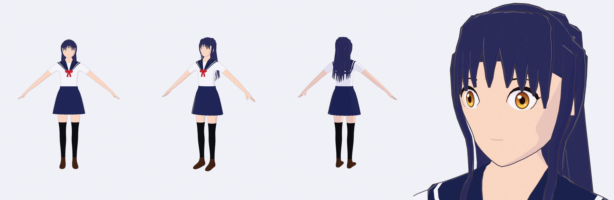
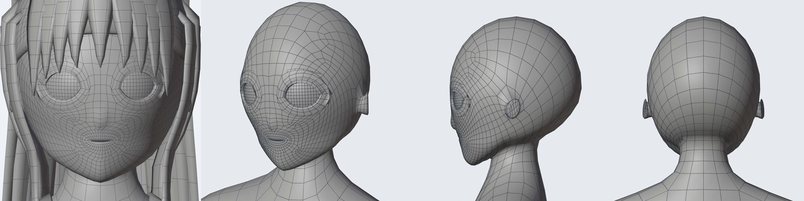
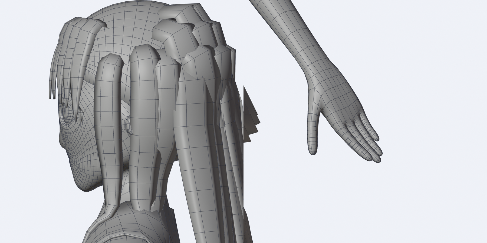
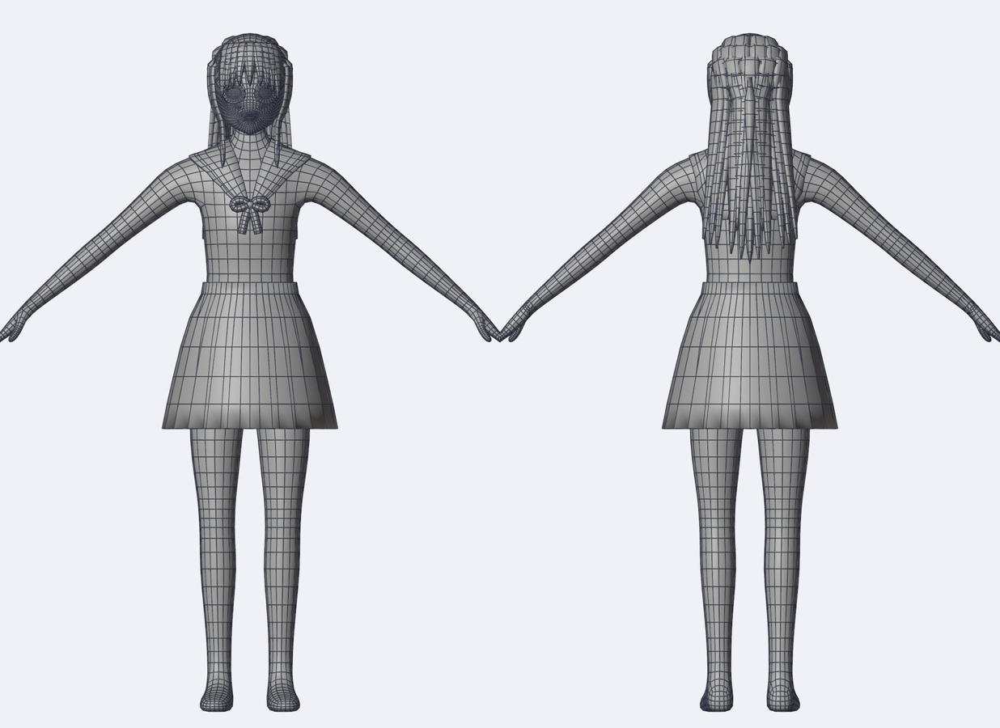
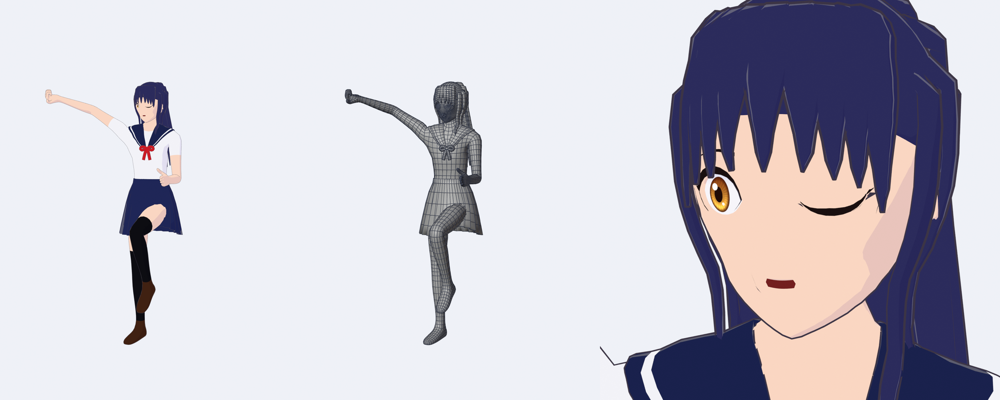
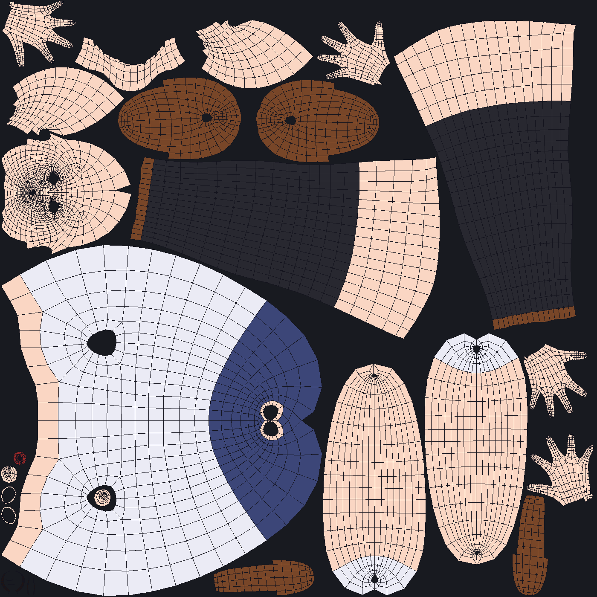

# Game-ready anime character: Blender, built entirely by code



A rigged anime schoolgirl for use in a game, generated by one Python script
([`build_character.py`](build_character.py)) with no downloaded meshes or textures. The priority
was **topology that deforms well**:

- all-quad edge flow with loops placed where joints bend
- a game skeleton with IK controls
- clean, engine-friendly skin weights
- face shape keys
- UVs

| file | what it is |
|---|---|
| [`anime_character.blend`](anime_character.blend) | the rigged character (Blender 4.5 LTS; opens in 4.5 and newer) |
| [`export/anime_character.fbx`](export/anime_character.fbx) | Unity / Unreal: skinned mesh, deform bones only, shape keys, embedded iris texture |
| [`export/anime_character.glb`](export/anime_character.glb) | Godot / web / three.js: the same as glTF binary |
| [`build_character.py`](build_character.py) | rebuilds everything above in about a minute |
| [`render_previews.py`](render_previews.py) | the toon-shaded and wireframe images in [`renders/`](renders/) |

## Budget

| mesh | triangles | notes |
|---|---:|---|
| Body | 11,188 | skin + outfit painted by material, eyes, lashes, brows, mouth bag |
| Hair | 7,256 | scalp cap + 33 ribbon locks |
| Skirt | 1,344 | 24 pleats, double-sided shell with a closed hem |
| Collar | 1,504 | sailor collar with stripe + ribbon bow |
| **total** | **21,292** | a mid-range hero character budget |

- **Skeleton:** 97 deform bones (105 with the IK controls).
- **Skinning:** at most 4 bone influences per vertex, normalised.
- **Materials:** 8 on the body and 1 to 3 on the other meshes; all plain Principled base colours plus one iris texture.
- **Scale and pose:** real-world metres, 1.60 m tall, standing in an A-pose (arms 40° down).

## Topology



The head is laid out the way anime heads are retopologised by hand:

- **The face is a polar grid around the mouth.** The lip loops grow outward:
  - into the muzzle
  - under the nose and around the nose bridge and cheeks
  - over the brow
  - out to the hairline and along the jaw

  Lines fan from the chin up through the cheeks.
- **The vertex count grows outward.** The lip line has 16 vertices (32 after subdivision), and the outer face loops have 24.
  - Four 1→3 transition cells make up the difference. They put the poles in the nasolabial and jaw area, where real faces carry them.
  - This avoids a dense "bullseye" around the mouth.
- **Each eye is set into the face loops.**
  - It replaces a 3×2-cell block and gets two inset rings.
  - The almond lid rim has 20 vertices with five loops around it.
  - The rim is extruded back into a socket wall, so you never see into the head.
- **A hood covers the cranium.**
  - Its rows arc from temple to temple over the head; its columns run from the hairline to the base of the skull.
  - It widens from 6 to 10 columns just behind the hairline and narrows back at the nape. Those poles sit under the hair.
  - The ears grow out of 1×2 sockets in it.
- **The jaw flows into the neck.** The bottom of the outermost face loop is the throat, and together with the hood's bottom edge it forms the 8-vertex neck ring.





The body is box-modelled as a cage and given one Catmull-Clark subdivision:

- **Density:** 24 around the torso and 16 around the limbs.
- **Joints:** three loops at the shoulders, elbows, wrists, hips, knees and ankles.
- **Hands:**
  - The hand widens from the 16-around wrist into a 20-around palm through one transition cell on the pinky side.
  - Fingers are 4-sided rings (8 after subdivision) with loops at every knuckle.
- **Groin:** a diamond quad at the front and back of the crotch line keeps every vertex there at five edges or fewer.
- **Hair:**
  - The cap is the scalp's own quads lifted off the skin, with one extra subdivision.
  - Every lock is a closed 6-sided ribbon with clean loops along its length. The locks are draped by a small gravity-and-collision simulation and taper to a point.

**Health checks:**
- Every face is a quad.
- The meshes are manifold, apart from the eye and mouth openings, which are closed off behind by the socket walls and mouth bag.
- The body is exactly mirror-symmetric, so X-mirror weight painting and pose mirroring work.
- All normals face outward.

## Rig



- **Deform skeleton (exported):**
  - `Root → Hips → Spine → Chest → UpperChest → Neck → Head`
  - `Eye.L/R`
  - `Shoulder → UpperArm → LowerArm → Hand`, with `Thumb/Index/Middle/Ring/Pinky_1..3` on each hand
  - `UpperLeg → LowerLeg → Foot → Toes`
  - Names follow Blender's `.L`/`.R` convention. Rolls are set so limbs bend around their local X axis.
- **Physics chains (exported):**
  - `HairSide_1..3.L/R` for the face-framing locks
  - five `HairBack_*_1..4` chains for the long hair
  - eight `Skirt_*_1..2` chains around the skirt

  Hook them up to your engine's spring-bone or cloth system: VRM SpringBone, Magica Cloth or Dynamic Bone in Unity; AnimDynamics or Kawaii Physics in Unreal. The skirt also carries a little thigh weight, so a raised leg doesn't pass straight through it when physics is off.
- **Animator controls (Blender only, not exported):**
  - `IK_Foot`, `Pole_Knee`, `IK_Hand` and `Pole_Elbow` for each side.
  - IK/FK switches are custom properties on the Armature object: `IK_Leg.L/R` (default 1 = IK) and `IK_Arm.L/R` (default 0 = FK).
  - Bones are sorted into the *Deform*, *Physics* and *Controls* bone collections.
- **Weights:**
  - Body: Blender's bone heat, then rigid weights for the eyes (to the eye bones), and for the lashes, brows, sockets and mouth bag (to the head).
  - Hair and skirt: computed from how they were built, i.e. each vertex's position along its lock or chain.
  - Collar: copied from the nearest body vertices.
- **Shape keys:** `Blink`, `Blink_L`, `Blink_R`, `Mouth_A`, `Mouth_I`, `Mouth_U`, `Mouth_E`, `Mouth_O`, `Smile`.
  - Blinks close the upper lid onto the lower one, and the lash line follows, giving the anime closed-eye curve.
  - The mouth shapes are a jaw rotation plus lip shaping.

## UVs



- **Body:** seams sit on region borders (face | back of head, ears, neck, torso, arms, hands, legs, shoe sole | upper).
  - One cut per tube, placed where it's hard to see: down the back for the head, neck and torso, along the underside of the arms, and down the inside of the legs.
  - Hands split into back and palm.
  - All of it is unwrapped angle-based and packed into one 0–1 space.
- **Eyeballs** keep their own UVs for the iris texture (a separate material).
- **Hair locks** have strand UVs (across the lock × along its length), ready for a gradient or strand texture.
- **Skirt and collar** are UV'd as they're built.

## Using it

**Unity:**
1. Drop in the FBX.
2. Set *Rig → Animation Type: Humanoid*. Check the auto-mapping (the bone names are standard), and use *Enforce T-Pose* if your animations expect one.
3. Use a toon shader such as UTS2 or lilToon. Set the skirt material to render both faces if your shader culls back faces (the skirt is a closed shell, so it's optional).

**Unreal:** import the FBX as a skeletal mesh. Keep *Import Morph Targets* on and *Use T0 as Ref Pose* off (the rest pose is the A-pose).

**Godot:** import the GLB. The skeleton, skin and blend shapes come through as-is.

**Rebuild or modify:**

```bash
blender -b -P build_character.py -- --save anime_character.blend --fbx export/anime_character.fbx --glb export/anime_character.glb
```

```bash
blender -b anime_character.blend -P render_previews.py -- renders_out
```

```bash
blender -b anime_character.blend -P render_previews.py -- renders_out --pose
```

The look is set by constants near the top of each section of `build_character.py`:

- **Body:** `TORSO`, `ARM_RINGS`, `LEG_RINGS` and `FINGERS` (body proportions); `ARM_DROP` sets the A-pose angle.
- **Head:** `HEAD_FRONT`, `HEAD_BACK` and `HEAD_W` are the head silhouettes; `EYE_TOP`/`EYE_BOT` shape the eye; `MOUTH_*` the mouth.
- **Hair:** `hair_recipes()` lists every lock.
- **Clothes:** `PALETTE` holds the colours; `SKIRT_RINGS` and `COLLAR_SPOKES` shape the outfit.

## Limitations

- **Generated, not hand-made.**
  - The edge flow is deliberate everywhere, but a character artist would still beat it on the finer points: a hand-tuned anime face, how the hair clumps together, and silhouette appeal.
  - Treat it as a clean, rig-ready base to refine, not a finished art asset.
- **No painted textures.** Colour comes from materials, plus a generated iris. The UVs are ready for painting.
- **Twelve valence-6 poles,** where adjacent fingers meet at the knuckle webs. This is the usual compromise for 4-sided fingers grown from one knuckle row. They sit in the web crease, which barely deforms.
- **The cranium is lighter than the face** (by design for a hair-covered scalp). Up close, the bald skull silhouette is slightly faceted; the hair cap is subdivided separately, so the visible silhouette is smooth.
- **The skirt and long hair need physics or spring bones** in the engine to move with the body. Rigidly skinned, they'll clip in extreme poses.
- **No teeth or tongue.** The mouth bag is a dark cavity, which is enough for anime-style mouths.
- **The toon look is a render-time setup in `render_previews.py`.** The saved materials are plain base colours so the exporters carry them cleanly; use your engine's toon shader.
