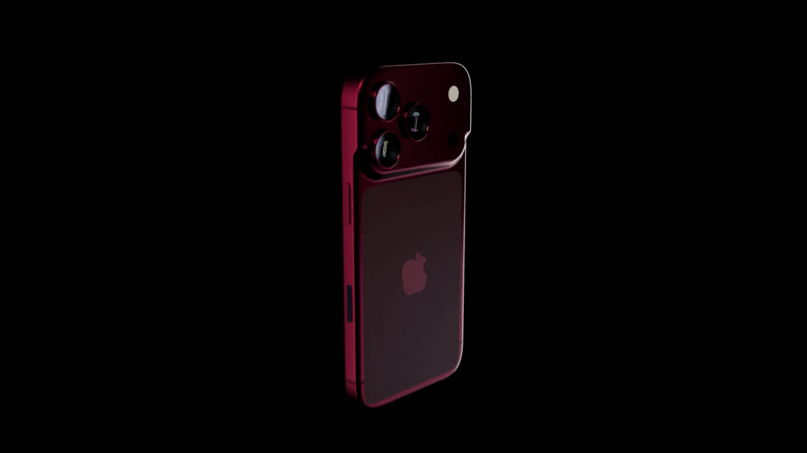
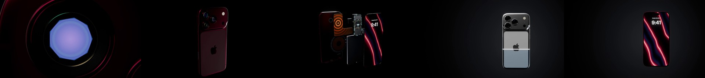
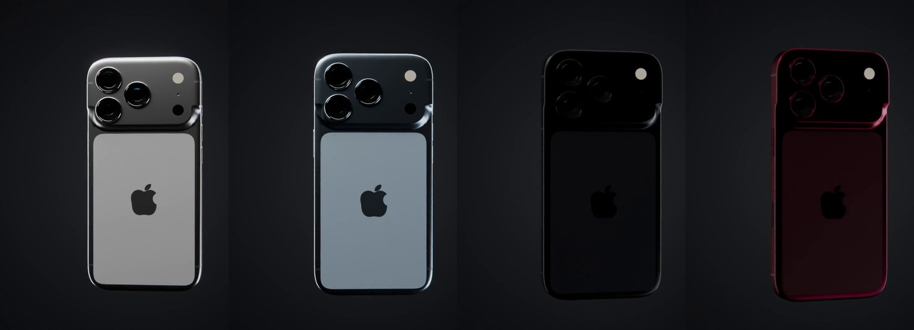

# iPhone 18 Pro: a 1:1 model and a 24-second ad (Blender + Cycles)



**Video:** [`renders/iphone18pro_ad.mp4`](renders/iphone18pro_ad.mp4): 24 s, 1920 × 1080, 24 fps, H.264 + AAC
stereo sound. Everything in it, including the soundtrack, is generated by
[`iphone18_ad.py`](iphone18_ad.py). No downloaded models, textures, HDRIs or audio.



## Why the "Pro"

As of November 2026 Apple has released only the **iPhone 18 Pro / Pro Max**. The plain iPhone 18
is not expected until spring 2027, and there are no published dimensions for it. So this is the
**iPhone 18 Pro**, modelled from Apple's own
[dimensional drawing](https://developer.apple.com/download/files/accessories/dimensional-drawings/iphone-18-pro.pdf)
(dated 2026-09-09).

## How "1:1" it is

The model is built in real units (metres, displayed in mm). The phone is 71.85 × 150.01 × 8.75 mm, exactly
as in the drawing.

| Taken directly from Apple's drawing | Measured off the drawing's outlines (est.) | Illustrative only |
|---|---|---|
| Outline and squircle corners (19.43 mm blend, Detail A) | Corner superellipse exponent (fitted to Detail A's points) | Everything inside the phone (board, battery, vapour chamber, MagSafe, camera modules) |
| Edge profile: 1.20 mm front lip, ~3.8 mm back round (Detail B) | Camera-plateau slope and where it steps down the sides | Lens internals (elements, iris mechanism, sensor) |
| Camera plateau height 2.78 mm, lens glass +2.11 mm | Back-glass window corners and insets | Antenna-band positions |
| Three Ø16.58 lenses, Ø6.90 flash and LiDAR, Ø1.15 mic, at their drawn centres (Detail D) | Apple-logo silhouette (built from circles, sized to the drawing's 16.32 × 20.04 box) | Lock-screen wallpaper |
| Display active area 66.57 × 144.73, cover glass 69.45 × 147.61, Dynamic Island 15.66 × 6.07 | | |
| Action, volume, side buttons, Camera Control and SIM tray: centres, lengths, widths, 0.45 mm protrusion | | |
| USB-C (9.00 × 3.14), ten Ø1.53 speaker/mic holes, two Ø1.50 screws (Detail C) | | |

The colours are the four launch finishes: **Silver, Glacier, Black, Burgundy**. The values are eyeballed;
Apple doesn't publish colour values.



## The ad: what's in it

| # | Shot | Time | What happens |
|---|---|---|---|
| 1 | **Iris** | 0–4.5 s | Extreme macro inside the 48MP Fusion Main lens. A modelled 9-blade iris clicks through the camera's four real apertures, **ƒ/4.0 → ƒ/2.8 → ƒ/1.8 → ƒ/1.48**, and violet light floods in through the opening. Each click has its own sound. |
| 2 | **Reveal** | 4.5–9.5 s | The camera pulls straight back out of the lens and zooms out to the whole back while a light bar sweeps across the plateau. |
| 3 | **Inside** | 9.5–14.5 s | Exploded view, fanned like a deck of cards: unibody, MagSafe magnets and coil, copper vapour chamber, camera modules, battery, logic board, display. The A20 Pro chip wakes up, heat ripples out through the vapour chamber, then everything snaps back together. |
| 4 | **Finish** | 14.5–19.5 s | Turntable. A scan line sweeps up the phone and re-anodises it on the way through all four finishes: Silver, Glacier, Black, back to Burgundy. |
| 5 | **Hero** | 19.5–24 s | The phone spins to the front, the display wakes at 9:41, end title: *iPhone 18 Pro. Let the light in.* |

The ideas I added beyond a plain turntable:

- **The opening is the feature.** The variable aperture is the headline camera change, so the ad opens
  *inside* the lens and makes the four real ƒ-stops the first beat, with the on-screen numbers and the
  sound synced to each blade click.
- **One story about light.** Light through the iris, light sweeping the body, the chip lighting up,
  the screen waking, and the tagline *Let the light in.*
- **Colour change as a physical event.** Instead of a cross-fade, a glowing scan line "re-anodises"
  the aluminium, back glass and lens rings in one pass, using a single shared shader group.
- **Procedural sound design.** A pad, metallic iris ticks, whooshes, sub hits, scan "zaps", a wake
  chime and a final hit, all synthesised in numpy and convolved with a generated room, then muxed in
  by Blender's own FFmpeg.

## Usage

**Prebuilt file:** [`iphone18pro_ad.blend`](iphone18pro_ad.blend) (6.5 MB, saved with Blender 5.0.1) is the
whole ad, ready to open. It opens on the reveal shot in camera view. Press **Space** to play, **F12** to render a frame,
or *Render › Render Animation*. Fonts and the logo mask are packed inside. Blender 5.0 or newer opens it.
For 4.2–4.5, generate your own with the script.

**The titles and sound are not in the .blend's render.** Render Animation gives the raw shots. To get
the finished ad, render the frames as PNGs, then run the `--edit` step below. You can also extract
them from an MP4 first:
`ffmpeg -i render.mp4 -start_number 1 frames/frame_%04d.png`. That is how the video in this
folder was made.

Blender **4.2 or newer** (tested with 5.0.1). Titles use the free **Inter** font when it is installed.
Otherwise Blender's built-in font is used. Run these from this folder:

```bash
# build the scene and save a .blend (about 1 minute)
blender -b -P iphone18_ad.py -- --save iphone18pro_ad.blend

# one frame (e.g. the end card) at 1080p
blender -b -P iphone18_ad.py -- --still 560 --out end_card.png

# all 576 frames, then cut them with titles + sound into the final MP4
blender -b -P iphone18_ad.py -- --frames renders/iphone18pro_frames
blender -b -P iphone18_ad.py -- --edit renders/iphone18pro_frames --out renders/iphone18pro_ad.mp4

# just the model, from a few angles, in a neutral studio
blender -b -P iphone18_ad.py -- --inspect back34,front34,plateau,bottom --outdir .
```

| option | meaning |
|---|---|
| `--quality draft\|final` | mesh density: outline points every 0.6 mm or 0.3 mm (default `final`) |
| `--res WxH`, `--samples N`, `--noise T` | resolution (default 1920x1080), Cycles samples (default 12) and adaptive noise threshold (default 0.05). OpenImageDenoise is always on |
| `--frames DIR [--range A-B]` | render PNG frames. Existing frames are skipped, so an interrupted render resumes |
| `--edit DIR --out FILE.mp4` | titles, fade, soundtrack, H.264 encode. Generates `soundtrack.wav` if missing |
| `--audio FILE.wav` | only write the soundtrack |
| `--still N --out FILE` | render a single frame |
| `--inspect VIEWS` | model check renders (`back34, front34, plateau, bottom, side, lensmacro, back, front`) |
| `--no-motion-blur`, `--threads N`, `--save FILE` | as named |

**Render time.** On a 4-core CPU with no GPU, 1080p at 12 samples took 45–60 s per frame for the lens
macro shots and about 20–30 s for the rest, so roughly 5 hours for all 576 frames. A GPU is much faster. To use
it, turn on *Preferences › System › Cycles Render Devices*, open the .blend and set *Render › Device* to GPU.
The `--edit` step takes about 2 minutes.

## Tweaking

At the top of `iphone18_ad.py`:

- `SPEC`: every dimension, with where it came from.
- `FINISHES` / `FINISH_ORDER`: the colours and the order of the scan.
- `SHOTS`, `IRIS_STEPS`, `EXPLODE`: shot timing, when each ƒ-stop clicks, and how far each layer flies out.
- `TITLES`: on-screen text, timing and placement.

## Things to know

- **It's a fan piece.** "iPhone" and the Apple logo are Apple's trademarks. Fine for a portfolio or a
  concept reel, but don't run it as a real ad.
- **The internals are made up.** They are plausible shapes in roughly the right places, not a teardown.
- **The exterior is as accurate as the drawing allows.** The drawing gives positions and sizes, not
  every fillet. The estimated shapes are listed in the table above and marked `(est.)` in the code.
